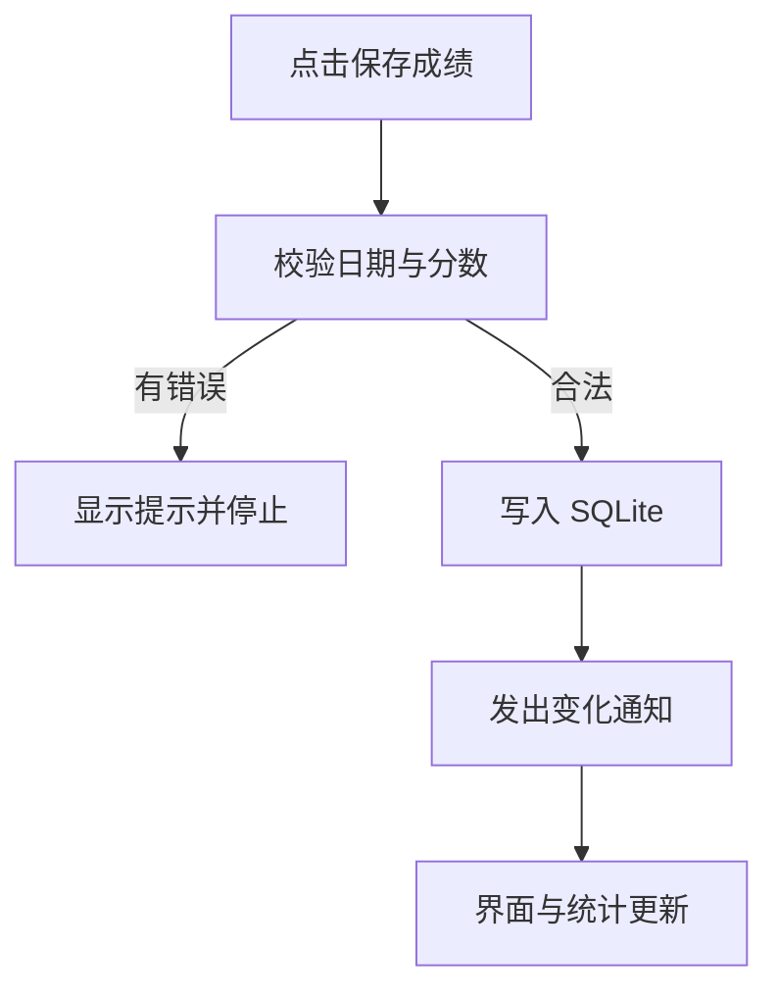

# 功能模块与源码导读

先把程序理解成三件事：界面接收输入，规则判断输入是否合理，存储把结果保留下来。AI 复盘还会增加一次联网请求。

## 文件怎样分工

以下 Kotlin 文件都在 `app/src/main/java/cn/yantu/records/`。

| 文件 | 主要职责 | 建议先找的符号 |
| --- | --- | --- |
| `Countdown.kt` | 把日期差变成倒计时文字 | `countdownText()` |
| `ScoreRule.kt` | 科目满分、早期英语口径、政治题数计分 | `scoreRule()`、`PoliticsParts` |
| `ScoreParts.kt` | 主观与客观满分、得分、校验和序列化 | `validate()`、`total` |
| `Records.kt` | 数据对象、本地 SQLite、查询/写入、初始试卷入口 | `Paper`、`Attempt`、`RecordDao`、`seedMissingPapers()` |
| `MainActivity.kt` | 启动、首页、页面切换、试卷列表、设置、图片查看 | `onCreate()`、`App()`、`Home()` |
| `RecordEditor.kt` | 成绩输入、笔记草稿、图片导入、保存和单卷分析 | `RecordEditor()`、`saveRecord()` |
| `StatisticsPage.kt` | 每卷最终成绩、分项趋势、四科得分率 | `currentResults()`、`StatisticsPage()`、`ScoreTrend()` |
| `Backup.kt` | CSV 导出、完整 ZIP 导出和恢复 | `export()`、`restore()` |
| `AiUi.kt` | 共用 API 设置表单、单卷/本科分析按钮与状态 | `AiSettings()`、`AnalysisPanel()` |
| `AiClient.kt` | 配置加密、请求 JSON、HTTPS、资料筛选、报告存储 | `AiConfigStore`、`AiClient`、`AiAnalyzer`、`AiReports` |

## 先认识保存的数据

| 对象 | 可以理解成什么 | 关键字段 |
| --- | --- | --- |
| `Paper` | 一个试卷入口 | `subject` 科目、`paperKey` 稳定键、`title` 标题、`kind` 类型 |
| `Attempt` | 这张卷的一份最终成绩与复盘 | `id`、`score`、`minutes`、`modules`、`notes` |
| `Attachment` | 图片的索引与说明 | `attemptId` 指向成绩，`fileName` 指向图片文件 |
| `Draft` | 未正式提交的笔记草稿 | `attemptId`、`content` |

例如 `Paper("政治", "X01", "肖1", "自定义练习")` 表示政治的肖1入口。把标题改成“肖1·已核对”，稳定键 `X01` 仍保持不变，已有成绩还能找到这张卷。

图片文件和图片索引分开保存：数据库记“文件叫什么、属于哪条成绩”，应用内部 `files/images` 目录保存真正的图片字节。这样图片能单独查看，也能随完整备份打包。

`Attempt.modules` 是一个文本字段，装的是 JSON。主观/客观使用 `ScoreParts.encode()`，政治使用 `PoliticsParts.encode()`。界面用 `decode()` 把 JSON 文本恢复为对象。`Attempt.score` 则保存最终总分，旧记录没有分项时仍可保留总分。

## 跟着“保存一次政治成绩”读代码

假设输入：单选总题数 16、答对 14；多选总题数 17、答对 13。

1. `MainActivity.kt` 的 `PaperDetail()` 找到已有成绩，或创建新记录对象，然后进入编辑页。
2. `RecordEditor.kt` 用输入框保存四个字符串。键盘输入首先得到文字，例如 `"16"`，还不是整数。
3. `toIntOrNull()` 尝试转换，转换失败得到 `null`，可以提示用户修正。
4. `PoliticsParts(16, 14, 17, 13)` 得到题量满分 `16 + 17 × 2 = 50`，得分 `14 + 13 × 2 = 40`。
5. 点击保存后，`saveRecord()` 调用 `validate()`。它同时检查非负、题量合计、答对数不超过总题数。
6. 输入合法时，`encode()` 生成 JSON，`persisted.copy(...)` 生成新记录，再调用 `db.dao().putAttempt(updated)`。
7. `RecordDao` 更新或插入 SQLite，随后 `notifyChange()` 发出变化通知。
8. 订阅该数据的界面重新查询；统计页通过 `currentResults()` 和 `reportedScore()` 得到新分数。

注意：笔记停改约 600 毫秒后会保存草稿，完整成绩表则通过保存按钮提交。`remember` 里的变量是界面状态；SQLite、草稿表和图片文件负责长期保存。

## 数学、英语、408 怎样计分

`ScoreParts` 保存四个数：客观满分、客观得分、主观满分、主观得分。`validate(fullMark)` 检查两类满分之和与科目满分相符，得分不超过对应满分，总分是两类得分之和。

`scoreRule(subject, key)` 按卷决定满分：

| 科目/试卷 | 满分与规则 |
| --- | --- |
| 数学二、408 | 150，主观和客观分项由用户设置 |
| 英语二 Y2005—Y2015 | 仅客观题，60 |
| 英语二 Y2016—Y2026 | 100 |
| 政治 | 仅选择题，50；单选每题 1 分、多选每题 2 分 |

`reportedScore()` 统一处理展示口径：早期英语有分项时优先读客观得分；政治和其他情况使用保存的最终分数。统计汇总按满分分组显示均分，得分率用“该卷得分 ÷ 该卷满分”计算。

## 折线图怎样画出来

先看 `StatisticsPage.kt` 的 `currentResults()`：按科目和试卷键分组，挑最新记录，排除“不适用”和无成绩的入口，再得到 `ChartDatum` 列表。

`ScoreTrend()` 使用画布：

- `x` 由点的序号和间距决定，卷多时横向滚动。
- 屏幕的 y 轴向下，所以 `y = bottom - 得分 / 图上最大值 × 绘图区高度`；得分越高，点越靠上。
- 相邻点用线连接，随后画圆点和分数。数字下面加留白底，保持文字可读。
- 点击时按横坐标找到最近一个点，把它的键保存到 `selected`，图下卡片显示这份记录的明细。

可先改标签字号 `10.sp` 或点间距 `82f` 看效果。要区分：`sp` 用于文字大小，`dp` 用于布局尺寸；画布绘制时再转换为像素。

## AI 分析的完整调用过程

以“保存并分析本卷”为例：

1. `AiUi.kt / AnalysisPanel()` 接收到按钮点击，显示分析中状态。
2. `snapshot` 回调进入编辑页的 `saveRecord()`，先保留当前有效输入；不合法时停止。
3. `AiAnalyzer.analyze()` 读取统一的 API 配置，确定当前单卷；本科汇总时则筛选所选科目的各卷最新记录。
4. 用记录 ID 关联图片，编排卷名、日期、分数、用时、分项、笔记和图片说明。勾选读图时才读取图片像素，旋转、缩放并编码成 Base64。
5. `AiClient.payload()` 把文字、图片和科目分析规则装成 JSON。`AiClient.complete()` 通过 HTTPS POST 发给配置的接口，并在请求头放入 API 密钥。
6. `parseResponse()` 提取模型返回的正文；`AiReports.save()` 按科目及单卷/本科范围保存在应用内部。
7. 面板更新报告文字，用户可选中复制。AI 报告不会自动替换用户的最终分数。

`AiConfigStore` 中有两种“密钥”：用户的服务商 API 密钥，以及 Android Keystore 中用于加密它的本机 AES 密钥。保存时把 API 密钥加密；实际发送请求时才解密使用。原个人工程中的 `signing/` 签名材料用于给 APK 签名，与这两者用途也不同；公开仓库只保留签名说明，不携带私钥。

网络代码放在 `Dispatchers.IO` 中。`suspend` 表示函数可以挂起，调用者通常要在协程里使用它；`suspend` 本身不会自动把代码切到后台线程，具体切换在 `withContext(Dispatchers.IO)` 等位置发生。

## 备份怎样保住记录

完整 ZIP 包含 `records.json` 和图片文件。JSON 中记录表数据、草稿、AI 报告及部分普通设置；API 密钥不进入成绩备份。

恢复时先解包到临时目录，验证格式、关联和图片是否齐全，再暂存旧图片/报告目录，放入新文件，调用 `RecordsDb.replaceAll()` 在数据库事务中替换记录。这个阶段失败时，事务回滚数据库，外层代码尝试恢复已移动的目录。最后恢复目标日期等设置，并补齐缺失的试卷入口。

数据库事务负责数据库行，文件目录由 `Backup.restore()` 自己协调。学习时可关注这两个处理范围，不把它们当成一个覆盖所有文件与设置的数据库事务。

## 读 Kotlin 时先认识这些写法

| 写法 | 这里的意思 |
| --- | --- |
| `val` / `var` | 只读变量引用 / 可以重新赋值的变量 |
| `data class` | 保存一组相关数据，可方便地 `copy()` 得到修改后的对象 |
| `Double?`、`String?` | 该值允许为 `null` |
| `?.`、`?:` | 非空时再取值；空时使用右边的备用值 |
| `@Composable` | 用于组合界面的函数，可以描述“当前状态下显示什么” |
| `remember { mutableStateOf(...) }` | 在当前组合中记住可观察状态；状态更新会带动相关界面重组 |
| `LaunchedEffect(...)` | 在界面组合生命周期内启动协程；键改变会取消旧任务并重新启动 |
| `Flow`、`collectAsState()` | 数据变化流；把流的最新值接成界面状态 |
| `use { ... }` | 使用后关闭文件流、Cursor 等资源 |
| `runCatching { ... }` | 把可能抛异常的操作包装成成功或失败结果 |
| `(String) -> Unit` | 一个回调函数：接收字符串，不返回有意义的业务值 |

第一轮能回答“按钮在哪个文件、调用哪个函数、数据最后存哪里”就已经够用。加密和网络细节可以等熟悉基本数据流后再看。
